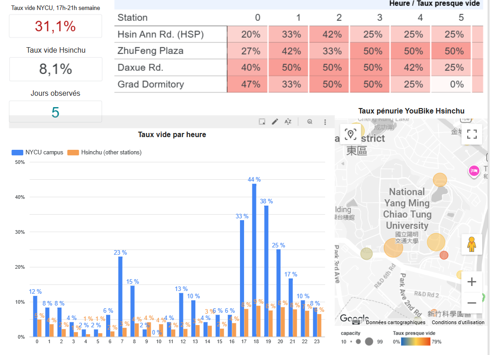
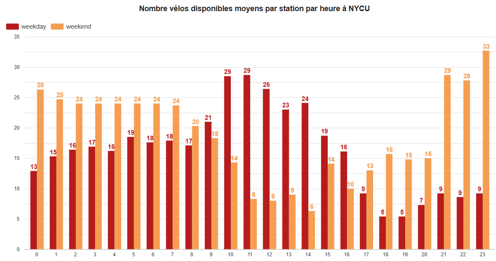
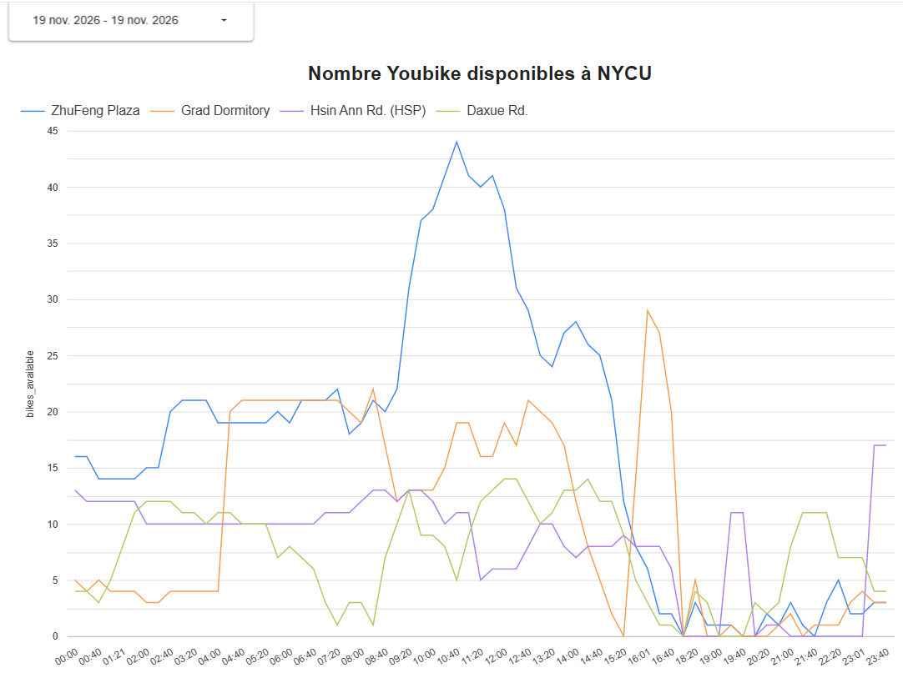
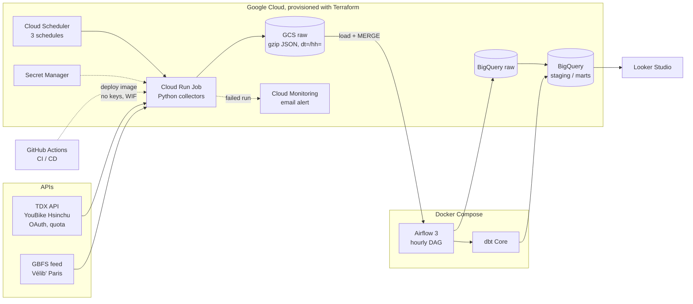

# Bike Availability Pipeline


**Why can't I find a YouBike on my campus at 5 pm?**
An end-to-end data pipeline that collects real-time bike-sharing availability, every few minutes, for **YouBike 2.0 in Hsinchu (Taiwan)** (and **Vélib' in Paris**), to measure where and when stations run out of bikes.

> 📊 **Live dashboard:** [Open the Looker Studio report](https://datastudio.google.com/reporting/844b9c3d-c9df-4a7e-a334-cb83ecc232b6)



---

## Key findings

While on exchange at **NYCU** (National Yang Ming Chiao Tung University, Hsinchu), I kept finding the campus YouBike stations empty in the evening. The data confirms it.

**Share of time a station has no bike at all, weekdays, 5 pm – 9 pm (local time):**

| Stations | Empty |
|---|---|
| NYCU campus (4 stations) | **30.4 %** |
| Rest of Hsinchu (213 stations) | 8.3 % |
| Paris, Vélib' (~1,500 stations) | 4.4 % |

*Data from 14 Nov 2026; figures computed on 19 Nov 2026 (4 weekdays observed). They are refreshed automatically as data accumulates; small samples, read as early indications.*

- **The campus empties after classes.** On weekdays, bikes accumulate on campus in the morning (students ride in) and the stations empty between 4 pm and 8 pm, when everybody leaves at once. At 6 pm, a campus station is empty 44 % of the time.
- **Rebalancing trucks are visible, but not enough.** Snapshot-level data shows sudden jumps that riders alone cannot explain, e.g. +16 bikes at the Graduate Dormitory at 4 am. On both 18 and 19 Nov, a station was refilled around 4 pm (0 → 29 bikes in 20 min on 19 Nov) and was **empty again within about an hour**; from 5 pm to midnight, all four campus stations stayed between 0 and 5 bikes. *(Two days observed: a trend to confirm.)*
- **Paris shows the opposite rhythm.** Shortages peak during office hours (9 am – 5 pm) in residential and hilly areas (Montmartre, 19th, 20th), a classic commuting pattern.

| Bikes per hour on campus (weekday vs weekend) | 19 Nov 2026 at NYCU, one point every 20 min |
|---|---|
|  |  |

---

## Architecture



| Layer | Tool | Role |
|---|---|---|
| Infrastructure | **Terraform** | Buckets, BigQuery datasets and tables, service accounts, IAM, Cloud Run, schedules, secrets |
| Collection | **Python**, **Docker**, **Cloud Run Jobs**, **Cloud Scheduler** | Calls the APIs 24/7, stores raw responses in GCS |
| Data lake | **Google Cloud Storage** | Raw JSON snapshots, Hive-style partitions in UTC |
| Orchestration | **Apache Airflow 3** (Docker Compose) | Hourly load GCS → BigQuery, then runs dbt |
| Warehouse | **BigQuery** | Partitioned and clustered tables |
| Transformation | **dbt Core** | Staging → intermediate → marts, 40+ tests, source freshness |
| Visualization | **Looker Studio** | Dashboard on the marts |
| CI / CD | **GitHub Actions**, **Workload Identity Federation** | CI on every push: `terraform validate`, `ruff`, `dbt parse`. CD: build, deploy and smoke-test the collector, with automatic rollback |
| Monitoring | **Cloud Monitoring**, **Error Reporting** | Email alert when a collector run fails |

---

## Data sources

| Source | System | Frequency | Access | License |
|---|---|---|---|---|
| [TDX](https://tdx.transportdata.tw/), Ministry of Transportation and Communications (Taiwan) | YouBike 2.0 Hsinchu, 217 stations | every 20 min | OAuth (client credentials), free tier ~3,000 calls/month | Open Government Data License v1.0 |
| [Vélib' Métropole](https://www.velib-metropole.fr/donnees-open-data-gbfs-du-service-velib-metropole) (GBFS) | Vélib' Paris, ~1,500 stations | every 5 min | Public, no key | Licence Ouverte (Etalab) |

There is no free official history for either source: the pipeline builds its own.

---

## How it works

### 1. Collection (serverless, 24/7)
- **One Docker image, one Cloud Run Job, three Cloud Scheduler triggers** with different arguments: Vélib' every 5 min, YouBike every 20 min, station lists once a day.
- The GBFS collector is generic (feeds discovered from `gbfs.json`): adding a GBFS city is one line.
- The TDX collector caches its OAuth token (valid 24 h) in a small GCS bucket, since the container disk is wiped after each run.
- Raw responses are stored **as received** (gzip), under `source/system/feed/dt=YYYY-MM-DD/hh=HH/` in UTC. Existing files are never overwritten.

### 2. Loading (Airflow, hourly, idempotent)
- One DAG run per hour of data, aligned with the `hh=` folders. **Dynamic task mapping**: one task per feed, so a failing feed does not block the others.
- Files are loaded into a temporary table, then **`MERGE` on the file name** into `raw.*`: re-running an hour never creates duplicates.
- **Catch-up**: Airflow runs locally and may be off; when it restarts, every missed hour is loaded from GCS. Nothing is lost while it is down.
- Exponential retries absorb transient network errors.

### 3. Transformation (dbt Core, run by Airflow)
- `LatestOnlyOperator`: during a catch-up, only the most recent run triggers `dbt build`, since incremental models reprocess the last days anyway.

| Layer | Models | Notes |
|---|---|---|
| staging | `stg_youbike__availability`, `stg_velib__station_status`, `stg_*__stations` | Unnest JSON (one row per station per snapshot). Incremental, `insert_overwrite` on daily partitions, clustered by station |
| intermediate | `int_station_snapshots` | **Both systems in one common shape**, with local time from a `systems` seed |
| marts | `dim_stations`, `fct_station_snapshots`, `mart_station_hourly_shortage`, `mart_data_coverage`, `mart_focus_station_timeseries` | Star schema; the dashboard mart stores **additive counts** |

**Data quality:** `unique`, `not_null`, a custom generic test `non_negative`, `relationships`, singular tests (count consistency, raw vs facts completeness), and `dbt source freshness` on every run.

### 4. CI/CD (GitHub Actions)
**CI** (`ci.yml`): every push and pull request on `main` runs three independent jobs, in about a minute, **without any cloud credentials**:
- **Terraform**: `terraform fmt -check` and `terraform validate` (no backend, no cloud access).
- **Python**: `ruff` lint on the collectors and the DAG (rules in `ruff.toml`, pinned version), then a syntax check.
- **dbt**: `dbt parse`, which catches broken `ref()`, invalid YAML and Jinja errors before they reach Airflow.

**CD** (`deploy.yml`): every push on `main` that changes `ingestion/` deploys the collector:
1. `ruff` again: nothing is deployed if lint fails.
2. Authentication with **Workload Identity Federation**: GitHub's signed OIDC token is exchanged for a short-lived GCP token. No key is stored in GitHub; only this repository, on `main`, can deploy, as a dedicated `github-deployer` account (push to this registry, update this job, nothing else).
3. Image built and pushed, **tagged with the commit SHA** (rollback = point the job to an older SHA).
4. Cloud Run Job updated, then a **smoke test**: one real Vélib' collection, which must succeed.
5. If anything fails, **automatic rollback** to the previous image; the workflow stays red.

Tested on purpose with a collector that crashes at start-up: lint passed, the smoke test failed, the previous image was restored about a minute later, and the alert email arrived.

### 5. Monitoring
- **Email alert** (Cloud Monitoring, log-based) as soon as a collector run exits with an error, at most one email per hour, with a short runbook in the message.
- **Error Reporting** groups Python tracebacks automatically.
- Validation errors include the start of the API response, so the cause is visible in the log itself.

---

## Design decisions

| Decision | Why |
|---|---|
| Collection in the cloud, orchestration on a laptop | Collection must never stop (no history to recover); loading can catch up later from GCS. Each component runs where its constraint requires. |
| ELT, raw JSON kept as-is in a `JSON` column | The two APIs have very different formats; parsing lives in versioned, tested dbt models. Anything can be rebuilt from raw. |
| Everything stored in UTC | Local time (Paris, Taipei, daylight saving included) is derived in dbt from a seed: adding a city is one CSV line. |
| Additive counts in marts (`n_empty`, `n_snapshots`, …) | Rates are re-aggregated correctly in the BI tool (`SUM/SUM`), never by averaging percentages. |
| 20-min sampling for YouBike | Fits the free TDX quota (~72 calls/day). More *days* matter more than more points per hour for this question. |
| No service-account keys | Local tools use gcloud ADC; Cloud Run uses its service identity; the TDX secret lives in Secret Manager. Least-privilege IAM on each bucket and dataset. |
| CI checks that need no credentials | Static checks catch most mistakes (syntax, broken references) at no cost and with no secret stored in GitHub. |
| Terraform owns the job, CD owns the image | The Cloud Run Job is defined in Terraform, but its image version is set by the CD (`lifecycle { ignore_changes }`), so a later `terraform apply` never reverts a deployment. |
| Reject empty API responses | An empty list is stored as nothing, not as "0 stations": the run fails loudly and triggers the alert. |
| No Nearline lifecycle rule | With many small files, per-object transition costs exceeded the storage savings. |

---

## Incidents and lessons learned

- **Silent catch-up stall.** All Airflow indicators were green, but loading had stopped: a manual `dags test` run occupied the logical date of a scheduled run. Found by counting rows in BigQuery, not by the UI.
- **DNS failures in Docker on WSL** made the worker unable to reach Google APIs for most of a day. Collection was unaffected (cloud), so no data was lost: failed runs were cleared and reloaded. Lessons: freshness checks do not detect *gaps* (hence the completeness test), and retries now use exponential backoff.
- **A 403 that wasn't a permission problem**: a stale `GOOGLE_APPLICATION_CREDENTIALS` in `.bashrc` pointed to another project's service account. First question on a cloud 403: *who* am I authenticated as?
- **A broken Terraform file was committed** (missing brace) and only noticed at the next `apply`. This is exactly what the CI now catches on every push.
- **TDX outage (25 Nov 2026, about 5 h).** From 07:20 to 12:40 Taiwan time, every TDX endpoint (all cities, station lists included) returned HTTP 200 with an empty list. The collector refused these responses, but nothing alerted: it was noticed by chance. The error message was improved to include the API response (deployed by the CD, which revealed `'[]'` on the first run), a minimal script ruled out the pipeline and the account (quota unused, no notice), and an email alert was added. The lost YouBike snapshots cannot be recovered: there is no upstream history.
- **The first smoke test failed** (an unfinished argument was committed), but the job had already been updated: the smoke test detected the problem without preventing it. Hence the automatic rollback step.

---

## Cost

Estimated **< $0.30 / month**: Cloud Scheduler (3 free jobs), Cloud Run Jobs and BigQuery within free tiers; a few cents of GCS storage and Secret Manager accesses; $0.10 for the alerting condition. GitHub Actions is free for public repositories, and Artifact Registry keeps only the 5 latest images. A GCP budget alert is set at €5, and every dbt query is capped (`maximum_bytes_billed`).

---

## Repository structure

```
.github/workflows/  CI (Terraform, ruff, dbt parse) and CD (collector deployment)
terraform/          GCP infrastructure (GCS, BigQuery, IAM, Cloud Run, Scheduler, Secret Manager,
                    Workload Identity Federation, alerting)
ingestion/          Python collectors (GBFS, TDX) and their Dockerfile
orchestration/      Airflow (Docker Compose, custom image with dbt) and the DAG
dbt/                dbt project: sources, staging, intermediate, marts, seeds, tests, macros
docs/               Dashboard setup and screenshots
ruff.toml           Python lint rules
```

---

## Reproduce

<details>
<summary>Setup steps</summary>

Prerequisites: a GCP project with billing, `gcloud`, Terraform, Docker, Python 3.12+, a free [TDX](https://tdx.transportdata.tw/) account.

```bash
# 1. Authenticate (no key files)
gcloud auth login && gcloud auth application-default login

# 2. Infrastructure
cd terraform && cp terraform.tfvars.example terraform.tfvars   # set project_id and alert_email
terraform init && terraform apply

# 3. TDX credentials into Secret Manager
printf '%s' "$TDX_CLIENT_ID"     | gcloud secrets versions add tdx-client-id --data-file=-
printf '%s' "$TDX_CLIENT_SECRET" | gcloud secrets versions add tdx-client-secret --data-file=-

# 4. First collector image (later versions are deployed by the CD on every push to ingestion/;
#    in a fork, set github_repository and the two identifiers in deploy.yml)
IMAGE=$(terraform output -raw collector_image)
gcloud auth configure-docker europe-west1-docker.pkg.dev
docker build -t "$IMAGE" ../ingestion && docker push "$IMAGE"

# 5. Airflow with dbt (from the repo root)
docker build -t bike-airflow:3.3.2 -f orchestration/Dockerfile .
cp orchestration/.env.example orchestration/.env               # fill in values
cd orchestration && docker compose up airflow-init && docker compose up -d
# UI: http://localhost:8080 — unpause load_raw_to_bigquery
```

Run the CI checks locally before pushing (from the repo root):

```bash
terraform -chdir=terraform fmt -check -recursive
ruff check ingestion orchestration/dags
(cd dbt && dbt parse)
```
</details>

---

## Limitations and next steps

- **Short history so far**: figures are early indications and will firm up with more weeks.
- 20-min resolution for YouBike: truck arrivals are located within ±20 min.
- The CI runs static checks only: data tests (`dbt build`) run in Airflow, against real data.
- Only collector failures are alerted; Airflow and dbt failures are only visible in the Airflow UI.
- The data depends on TDX availability: provider outages (like 25 Nov, or the announced maintenance of 27–30 Nov) leave gaps that cannot be filled.
- Next:
  - **Snowflake as a second dbt target**;
  - alert on dbt test failures and on data gaps (from `mart_data_coverage`);
  - automatic detection of rebalancing events, a GCS → BigQuery completeness test, a "service day" starting at 4 am.

---

## Author

**Anh-Tam Pho** — Data engineering student, exchange at NYCU (Hsinchu, Taiwan).
